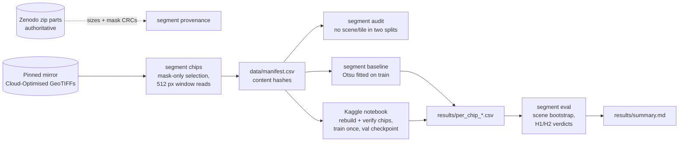

# Surface-water segmentation: U-Net vs NDWI-Otsu on held-out scenes

> Does a trained U-Net actually beat the threshold a remote-sensing analyst would try first, on
> Sentinel-2 scenes it has never seen? Pre-registered, scored once, scene-level uncertainty.

[](https://github.com/Prithv122/segmentation/actions/workflows/ci.yml)

**Live demo:** not deployed — runs locally (CPU inference on 512 px chips is fine)
**Stack:** Python 3.12 · PyTorch + segmentation-models-pytorch (U-Net, ResNet-34) · rasterio ·
NumPy · Pillow · Kaggle T4 for training

---

## 1. The problem

Water masks from satellite imagery feed reservoir monitoring, irrigation planning and wetland
inventories. The cheap, explainable method is a spectral index with a threshold: NDWI with Otsu's
cut needs no labels and no GPU. A segmentation network costs labels, training and serving, so it
has to earn its place on **new places**, not on random crops of the scenes it trained on.

Pixel models are easy to score generously: random chip splits leak neighbouring pixels between
train and test, and the threshold baseline is often left out. This project scores both methods on
16 Sentinel-2 scenes held out by the dataset's authors, with a decision rule fixed in advance
([`PREREG.md`](PREREG.md)).

S1S2-Water contains ordinary surface water (lakes, rivers, reservoirs, coast). Nothing here is a
claim about flood mapping.

## 2. The data

| | |
|---|---|
| Source | **S1S2-Water v1.0.1**, Wieland et al. 2024, IEEE JSTARS, [doi:10.1109/JSTARS.2023.3333969](https://doi.org/10.1109/JSTARS.2023.3333969), [Zenodo 11278238](https://zenodo.org/records/11278238) |
| Licence | **CC BY 4.0** (on the authors' Zenodo record) |
| Size | 65 Sentinel-2 L1C scenes, 10,980 × 10,980 px each; hand-labelled water and valid-pixel masks; about 165 GB as zipped |
| Split | The authors' split **by scene**: 33 train / 16 val / 16 test; no MGRS tile in two splits |
| Used here | 512 × 512 chips: 64 per train scene (half with water), 32 per val/test scene (uniform) — see `data/manifest.csv` |

Nothing from the dataset is committed. `data/scenes.csv` (scene metadata) and `data/manifest.csv`
(chip positions and content hashes) are, so anyone can rebuild the exact chips and check them.

**Why not Sen1Floods11 (the original plan)?** Its own STAC catalog lists the licence as
`proprietary` and its repository has no licence file. The licence check was a hard gate for a
public repo, so the dataset changed before any data was scored (PREREG amendment A0).

## 3. Architecture



## 4. Key decisions & tradeoffs

| Decision | Chose | Over | Why |
|---|---|---|---|
| Dataset | S1S2-Water (CC BY 4.0) | Sen1Floods11; SpaceNet 2 | Sen1Floods11 failed the licence check. SpaceNet buildings have no classical index baseline, so the question would change |
| Held-out unit | the authors' scene split, scored once | random chips | Neighbouring chips share texture, light and water bodies; a random split measures memory, not transfer |
| Uncertainty | paired bootstrap over **scenes** | over chips or pixels | Chips from one scene are correlated; resampling them as independent gives a falsely narrow interval |
| Model input | blue, green, red, NIR | all 13 bands | Same information NDWI uses (plus RGB), so the comparison is about the method, not extra bands |
| Baseline fit | Otsu on train pixels only, then frozen | per-scene Otsu | Per-scene Otsu would adapt to test scenes; a fixed threshold is the deployable equivalent of a trained model |
| Chip reads | 512 px windows from a pinned COG mirror, checked against Zenodo | full zip download | Zenodo throttled to ~0.5 MB/s per connection (165 GB); the mirror's tiles align with the chip grid |
| Chip identity | hash of array content | hash of the `.npz` file | Compressed bytes depend on the zlib build; a Kaggle rebuild must verify against the local manifest |

## 5. Results

_Pending: chips are being built; nothing has been scored yet. Every number here will come from
`results/summary.md`, regenerated from committed per-chip CSVs by `segment eval`._

## 6. How to run

```bash
git clone https://github.com/Prithv122/segmentation.git
cd segmentation
uv sync --all-groups --all-extras      # CPU torch
uv run pytest                          # fast suite; add -m slow to train a tiny U-Net on CPU
uv run segment eval                    # rebuild results/summary.md from the committed CSVs
```

Rebuild the data and the baselines (CPU, about an hour for the chips, ~4.5 GB on disk):

```bash
uv run segment chips --workers 8       # data/chips/, checked against data/manifest.csv
uv run segment verify
uv run segment audit                   # leakage audit
uv run segment provenance              # mirror vs Zenodo: sizes and mask CRCs
uv run segment baseline                # NDWI-Otsu, MNDWI-Otsu, constant on val and test
```

Train the U-Net: open `notebooks/train_kaggle.ipynb` on Kaggle (GPU T4, Internet on), set
`REPO_REF`, *Run all*. Download `results/` and commit it.

## 7. What I'd change at 100× scale

At 100× (6,500 scenes, or one continent re-mapped every Sentinel-2 revisit), the bottlenecks move
in this order:

1. **Data access, first.** Here, Zenodo's ~0.5 MB/s per connection forced a mirror and 512 px
   window reads. At scale, read Cloud-Optimised GeoTIFFs straight from a cloud bucket next to the
   compute (Sentinel-2 L2A COGs on AWS Open Data), and replace `ThreadPoolExecutor` with a
   distributed map (Dask or Ray) over scene × window. The manifest-plus-content-hash contract stays
   as it is: it is what makes a rebuild on other machines checkable.
2. **Labels, not compute.** 65 hand-labelled scenes are the real limit. The next step is weak
   labels from the threshold itself (NDWI-Otsu is at 0.96 IoU on clear water), with humans
   labelling only where the methods disagree: wetlands, flooded vegetation, shadow, turbid water.
3. **Evaluation by stratum.** Pooled IoU is dominated by big lakes. At scale, report IoU per land
   cover, per climate zone and per water type, with the scene bootstrap inside each stratum, and
   gate a model release on its worst stratum, not on the pooled mean.
4. **Serving.** A ResNet-34 U-Net is about 24 M parameters. Export it to ONNX and tile scenes with
   overlap and blending to avoid seams at chip edges. Run the threshold first and send only
   uncertain tiles (near the Otsu cut, or with vegetation in water) to the network.
5. **Cloud masking becomes the method.** This dataset's hand-made valid masks hide clouds from
   both methods. In production nobody hands you that mask, so a cloud and shadow model (or the L2A
   scene classification) has to sit in front, and its errors have to be scored together with the
   water model's.

---

## References

- Wieland, M., Fichtner, F., Martinis, S., Groth, S., Krullikowski, C., Plank, S., Motagh, M.
  (2024). S1S2-Water: A global dataset for semantic segmentation of water bodies from Sentinel-1
  and Sentinel-2 satellite images. *IEEE JSTARS*. Data CC BY 4.0.
- McFeeters, S. K. (1996). The use of the Normalized Difference Water Index (NDWI) in the
  delineation of open water features. *International Journal of Remote Sensing*.
- Xu, H. (2006). Modification of normalised difference water index (MNDWI). *IJRS*.
- Otsu, N. (1979). A threshold selection method from gray-level histograms. *IEEE SMC*.
- Ronneberger, O., Fischer, P., Brox, T. (2015). U-Net. *MICCAI*. Implementation:
  [segmentation-models-pytorch](https://github.com/qubvel-org/segmentation_models.pytorch) (MIT).
